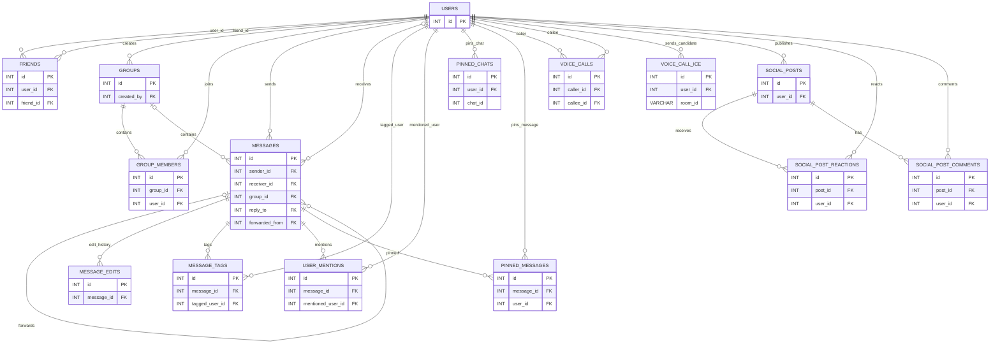

# ERD database sau khi tinh gọn

Lưu ý: `PINNED_CHATS.chat_id` có thể là ID người dùng hoặc ID nhóm tùy `chat_type`, do đó không phải khóa ngoại trực tiếp. `VOICE_CALL_ICE.room_id` liên kết logic với `VOICE_CALLS.room_id` nhưng schema không khai báo FK.
